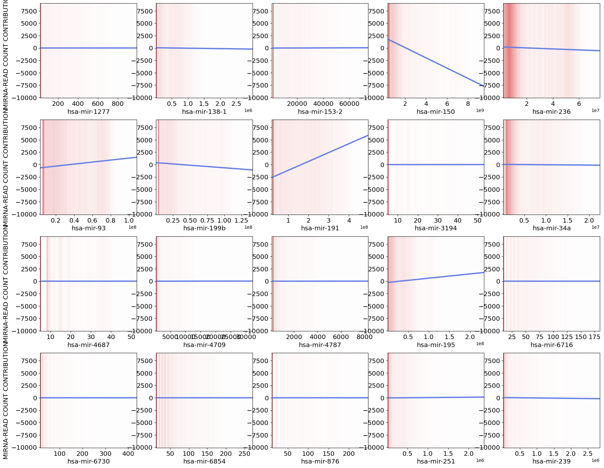
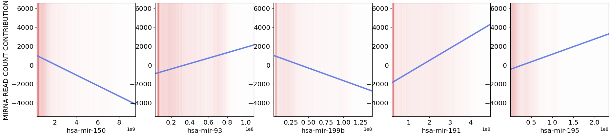
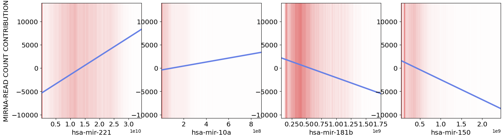
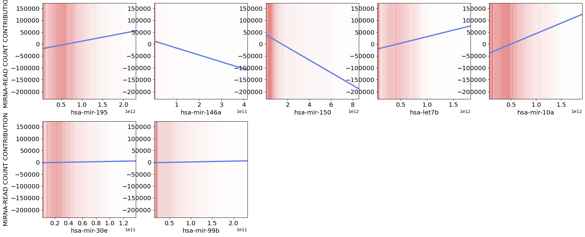

# Interpretable thyroid cancer classification from miRNA expression

Classifying thyroid tumor vs. normal tissue from miRNA expression with **Neural Additive Models (NAMs)**, so that every prediction can be broken down into one learned curve per miRNA.

This is the code for my M.Sc. thesis at Sharif University of Technology (June 2024), *"Replacing deep neural networks with new methods to increase their interpretability"*. Supervisor: Prof. Mojtaba Tefagh. Advisor: Prof. Abolfazl Motahari.

## Why NAMs

A standard deep network can separate tumor from normal samples, but it does not say which miRNAs it relied on or in what direction. A NAM keeps the flexibility of a neural network while staying additive:

```
logit(p(normal | x)) = b + f_1(x_1) + f_2(x_2) + ... + f_k(x_k)
```

Each `f_i` is a small neural network that only sees miRNA `i`. After training, `f_i` can be plotted directly. It shows how the expression level of that miRNA moves the prediction, with no post-hoc explanation method in between.

## Pipeline

```
TCGA-THCA miRNA counts (GDC, miRBase v21, 1,881 miRNAs)
50 tumor + 50 normal samples
        │
        ▼
ACTGAN, trained per class  ──►  ~10,000 synthetic samples (5,000 per class)
        │
        ▼
PyDESeq2: size-factor normalization, Wald test cancer vs. normal
keep miRNAs with p ≤ 1e-5  ──►  849 miRNAs
        │
        ▼
Feature selection: t-score | information gain | chi² | ReliefF
        │
        ▼
NAM (one feature network per miRNA), 5-fold split, sweep over dropout and number of basis functions
        │
        ▼
Shape functions per miRNA + global importance
```

Each selection method was run in three rounds:

1. Train a NAM on the top-k miRNAs from the method.
2. Remove the miRNAs whose shape function is flat (no effect on the prediction), then retrain.
3. Add random miRNAs from the 849 back in. This checks that the small set is not a lucky pick, since accuracy should not improve when extra features are added.

## Results

Accuracy on the held-out test fold:

| Selection | Round | # miRNAs | Accuracy |
|---|---|---:|---:|
| t-score | top-k | 20 | 94.59% |
| t-score | flat features removed | **5** | **96.34%** |
| t-score | + random | 50 | 92.84% |
| Information gain | top-k | 15 | 84.74% |
| Information gain | flat features removed | 4 | 81.65% |
| Information gain | + random | 45 | 80.35% |
| chi² | top-k | 10 | 81.24% |
| chi² | flat features removed | 7 | 80.54% |
| chi² | + random | 40 | 79.68% |

The best model uses only **five miRNAs**: hsa-mir-150, hsa-mir-93, hsa-mir-199b, hsa-mir-191 and hsa-mir-195. Adding 45 random miRNAs back lowers accuracy. Several of the selected miRNAs, such as miR-221 and miR-181b, have been linked to papillary thyroid cancer in earlier studies.

### Shape functions

t-score, 20 miRNAs. Most curves are flat, so the model effectively uses only a few features:



t-score, after removing flat features (5 miRNAs, best model):



Information gain, 4 miRNAs:



chi², 7 miRNAs:



How to read the plots: the blue line is `f_i` (contribution to the logit) plotted against the normalized count of that miRNA. The red shading shows where the samples are. Label 1 is normal tissue, so a curve going up means higher expression pushes toward *normal*, and a curve going down pushes toward *cancer*.

## Repository

```
├── notebooks/
│   └── thyroid_mirna_nam.ipynb   # full pipeline: data → DESeq2 → feature selection → NAM → plots
├── src/
│   └── feature_selection.py      # t-score, information gain, chi², ReliefF
├── figures/                      # shape-function plots from the thesis runs
└── requirements.txt
```

## Data

The data are not included. To rebuild them:

1. From the [GDC portal](https://portal.gdc.cancer.gov/), download **TCGA-THCA** files with *Data Type = miRNA Expression Quantification* (`*.mirbase21.mirnas.quantification.txt`). Take primary tumor samples for `Cancer/` and solid tissue normal samples for `Normal/`.
2. Train one ACTGAN (from [gretel-synthetics](https://github.com/gretelai/gretel-synthetics)) per class on these samples and sample 5,000 rows from each.

The notebook expects this layout:

```
data/
├── gdc/
│   ├── Cancer/*.txt
│   └── Normal/*.txt
└── synthetic/
    ├── actgan-cancer-data.csv
    └── actgan-normal-data.csv
```

## Running

The notebook was written for Google Colab, with the data on Google Drive. The first cell installs the dependencies. Restart the runtime after it finishes. To run locally:

```bash
pip install -r requirements.txt
cd notebooks
DATA_DIR=../data/ jupyter notebook thyroid_mirna_nam.ipynb
```

This repo is a cleaned-up version of the Colab notebooks I used during the thesis. The numbers above are the ones reported in the thesis.

## Acknowledgments

The NAM model and data utilities come from Google Research's [`neural_additive_models`](https://github.com/google-research/google-research/tree/master/neural_additive_models) (Apache 2.0):

> R. Agarwal, L. Melnick, N. Frosst, X. Zhang, B. Lengerich, R. Caruana, G. Hinton. *Neural Additive Models: Interpretable Machine Learning with Neural Nets.* NeurIPS 2021.

Data: The Cancer Genome Atlas (TCGA) Research Network, via the NCI Genomic Data Commons.

## Contact

Pedram Rajaei · prajaei@cougarnet.uh.edu
